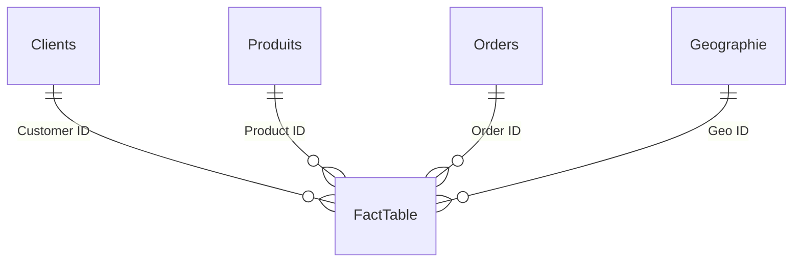

# 📊 Tableau de bord de suivi des ventes — Power BI


Rapport Power BI de suivi des ventes d'une enseigne américaine (2015 – 2018) : KPI globaux, évolution dans le temps, répartition par catégorie, segment client, région, État et ville.

<!-- Ajouter ici les captures d'écran des deux pages :


-->

---

## 🎯 Objectifs

- Suivre le chiffre d'affaires, le nombre de commandes et de clients, la vente moyenne et médiane.
- Analyser les ventes dans le temps (année, mois, jour) avec des segments interactifs.
- Comparer les ventes par catégorie de produits, segment client, région, État et ville.
- Mettre en place des mesures de cumul temporel (YTD / QTD / MTD).

## 🗂️ Contenu du dépôt

```
├── Tableau_de_bord_des_ventes.pbix   # Rapport Power BI (modèle + 2 pages)
├── README.md
└── screenshots/                       # (à ajouter) captures des pages du rapport
```

## 📥 Données

| Élément | Valeur |
|---|---|
| Source | `train.csv` (18 colonnes, une ligne par article commandé) |
| Lignes chargées | 9 799 |
| Période des commandes | 03/01/2015 → 30/12/2018 |
| Commandes uniques | 4 922 |
| Clients uniques | 793 |
| Produits | 1 861 références, 3 catégories, 17 sous-catégories |
| Segments clients | Consumer, Corporate, Home Office |
| Zone géographique | États-Unis : 4 régions (Central, East, South, West), 49 États |
| Ventes totales | ≈ 2 261 255 |

## 🧱 Modèle de données

Schéma en étoile : une table de faits et quatre dimensions, construites dans Power Query à partir du CSV.



| Table | Rôle | Colonnes principales |
|---|---|---|
| `FactTable` | Faits | Customer ID, Order ID, Product ID, Sales, Geo ID |
| `Clients` | Dimension | Customer ID, Customer Name, Segment |
| `Produits` | Dimension | Product ID, Category, Sub-Category, Product Name |
| `Orders` | Dimension | Order ID, Order Date, Ship Date, Ship Mode, Année, Trimestre, Mois, Jour, Mois en Lettre |
| `Geographie` | Dimension | Geo ID, Country, Region, State, City, Postal Code |
| `Calendrier` | Table de dates (2015 → 2018) | Date, Années, MoisNum, Mois, JourNum, Jour |

Relations : plusieurs-à-un (M:1), filtrage dans un seul sens, toutes actives.

### Transformations Power Query

- Import du CSV (encodage UTF-8, locale `fr` pour la conversion des montants).
- Séparation des dimensions par sélection de colonnes puis suppression des doublons.
- Création de colonnes de date sur `Orders` : année, trimestre, mois, jour.
- Création d'un identifiant `Geo ID` (index) pour la dimension géographique.

## 🧮 Mesures DAX

| Mesure | Formule | Usage |
|---|---|---|
| `Total vente` | `SUM(FactTable[Sales])` | Chiffre d'affaires |
| `Commande unique` | `DISTINCTCOUNT(FactTable[Order ID])` | Nombre de commandes |
| `Clients uniques` | `DISTINCTCOUNT(FactTable[Customer ID])` | Nombre de clients |
| `Moyenne de vente` | `DIVIDE([Total vente], [Commande unique])` | Panier moyen par commande |
| `Medianne des ventes` | `MEDIAN(FactTable[Sales])` | Médiane des ventes par ligne |
| `Ventes YTD` | `TOTALYTD([Total vente], Calendrier[Date])` | Cumul annuel |
| `Ventes QTD` | `TOTALQTD([Total vente], Calendrier[Date])` | Cumul trimestriel |
| `Ventes MTD` | `TOTALMTD([Total vente], Calendrier[Date])` | Cumul mensuel |

> Le panier moyen (`Moyenne de vente`, par commande) n'est pas la même chose que la moyenne par ligne utilisée dans le graphique « Moyenne des ventes par régions ».

## 🖥️ Pages du rapport

### Page 1 — Suivi des ventes par dates

- **Bandeau KPI** : Moyenne de vente, Médiane des ventes, Total vente, Clients uniques, Commandes uniques.
- **Courbe** : ventes par hiérarchie de dates (année / mois / jour, avec drill).
- **Anneau** : ventes par catégorie de produits.
- **Colonnes** : moyenne des ventes par région.
- **Barres** : ventes par État (tri décroissant).
- **Segments** : Année, Mois, Jour + bouton **Effacer** pour réinitialiser tous les filtres.

### Page 2 — Suivi des ventes par régions

- **Cartes** : ventes cumulées (`Ventes QTD`).
- **Carte de formes** (Shape Map, États-Unis) : répartition par État et par ville.
- **Secteurs** : ventes par segment client.
- **Tableau** : ventes par produit.
- **Entonnoir** : ventes par catégorie de produits.
- **Segments** : Ville, Segment (liste déroulante), État.

Un thème personnalisé est appliqué par-dessus le thème de base Fluent 2.

## ▶️ Utilisation

1. Ouvrir `Tableau_de_bord_des_ventes.pbix` avec **Power BI Desktop** (version récente, le rapport a été enregistré avec la version 2026.10).
2. La source est référencée par un chemin local : `D:\Projet Power BI Amazon\train.csv`. Placer `train.csv` à cet emplacement, ou modifier le chemin via **Accueil → Transformer les données → Paramètres de la source de données**.
3. Cliquer sur **Actualiser**.

## 🛠️ Compétences mobilisées

Modélisation en étoile · Power Query (M) · DAX (mesures, time intelligence) · Visualisation (KPI, drill, segments, carte de formes) · Conception de rapports multi-pages.

## ⚠️ Limites connues

<!-- À SUPPRIMER une fois les points ci-dessous corrigés dans le .pbix -->

- **Lien géographique incorrect** : `Geo ID` est régénéré indépendamment dans `FactTable` (0 à 9 798) et dans `Geographie` (0 à 627). Seules 628 lignes sur 9 799 (6,4 %, soit 7,1 % des ventes) trouvent une géographie, et sans correspondance réelle. Les visuels par État, région et ville ne sont pas fiables. Correction : fusionner `Geographie` dans la requête des faits sur Country / City / State / Postal Code / Region avant de supprimer ces colonnes.
- **`Calendrier` n'est relié à aucune table** : les mesures YTD / QTD / MTD ne filtrent donc pas par date. Correction : relation `Calendrier[Date]` → `Orders[Order Date]`.
- **Page 2** : les trois cartes affichent la même mesure (`Ventes QTD`) ; `Ventes YTD` et `Ventes MTD` ne sont pas utilisées.
- **Chemin de la source en dur** (voir *Utilisation*) et `Calendrier` limité à 2015 – 2018.

## 👤 Auteur

**Bertin** — Data Analyst
[GitHub](https://github.com/Gracias-Leader) · [LinkedIn](https://www.linkedin.com/in/Gracias-NDEMA)
